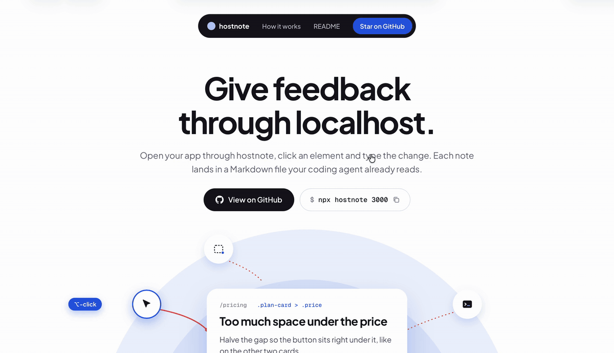

<h1 align="center">hostnote</h1>

<p align="center">
  <a href="https://github.com/RichardLitt/standard-readme"></a>
  <a href="LICENSE"></a>
</p>

<p align="center">Point at what's wrong on your running app. Your coding agent fixes it.</p>

<p align="center">
  
</p>

hostnote puts a notes layer on your local dev server. Click an element, select some text or draw a box, and type what's wrong. Your agent gets the exact spot, not your best description of it.

Each note is one line in `.hostnote.md`. Say "do my notes": the agent makes each change, deletes the line, and the note leaves the page.

- **Any stack.** hostnote is a proxy in front of your dev server. Nothing to install in your app, and hot reload keeps working.
- **Any agent.** Claude Code, Codex, or any agent that can read a file in your project.
- **Exact spots.** Each note carries the page, a CSS selector, and the text you selected or the box you drew.
- **Your other computers.** With `--tailnet`, open the page from any computer on your Tailscale network.
- **Local.** No account, no browser extension, no outside service. The notes are a Markdown file you can edit yourself.

## Install

Needs Node.js 22.15 or later. No dependencies.

```sh
npx hostnote 3000
```

Or install it once with `npm install --global hostnote`.

## Usage

### CLI

Start your dev server, then run hostnote with its port:

```sh
$ hostnote 3000
hostnote: localhost:3000 with notes at http://localhost:4000
notes: ~/code/my-app/.hostnote.md
```

Open the URL it prints instead of your dev server's. Add `--tailnet` to also serve it on your Tailscale address, under the machine's MagicDNS name.

### Keys

| Key | What it does |
|---|---|
| C | A note on the selected text. With nothing selected: click an element, or drag a box. |
| ⌥-click / ⌥-drag | The same, without pressing C first. |
| N / ⇧N | Next / previous note. |
| Escape | Cancel. |

Click a mark to open its note. Click the text to edit it, Return to save. The keys do nothing while you type in a field of the page.

### Tell your agent

Add this to your `AGENTS.md` or `CLAUDE.md`:

```md
When I say "do my notes", read `.hostnote.md`, act on each line, then delete it.
```

A note looks like this:

```md
- /pricing · `main > div:nth-of-type(2)` "Team plan $12 per seat" — too much space <!-- id:p0q1 -->
```

Don't want notes in git? Add `.hostnote.md` to your `.gitignore`.

## Is it safe?

hostnote listens on `127.0.0.1` only, plus your Tailscale address with `--tailnet`. It refuses requests under unknown domain names, which blocks DNS rebinding, and other sites cannot read or write your notes. To load its script, it drops the page's Content-Security-Policy header, so don't use it to judge your CSP.

## Contributing

Questions, bugs and pull requests are welcome in [issues](https://github.com/clementrog/hostnote/issues). `npm test` runs the checks, with headless Chrome for the page layer.

## License

[MIT](LICENSE) © clementrog
